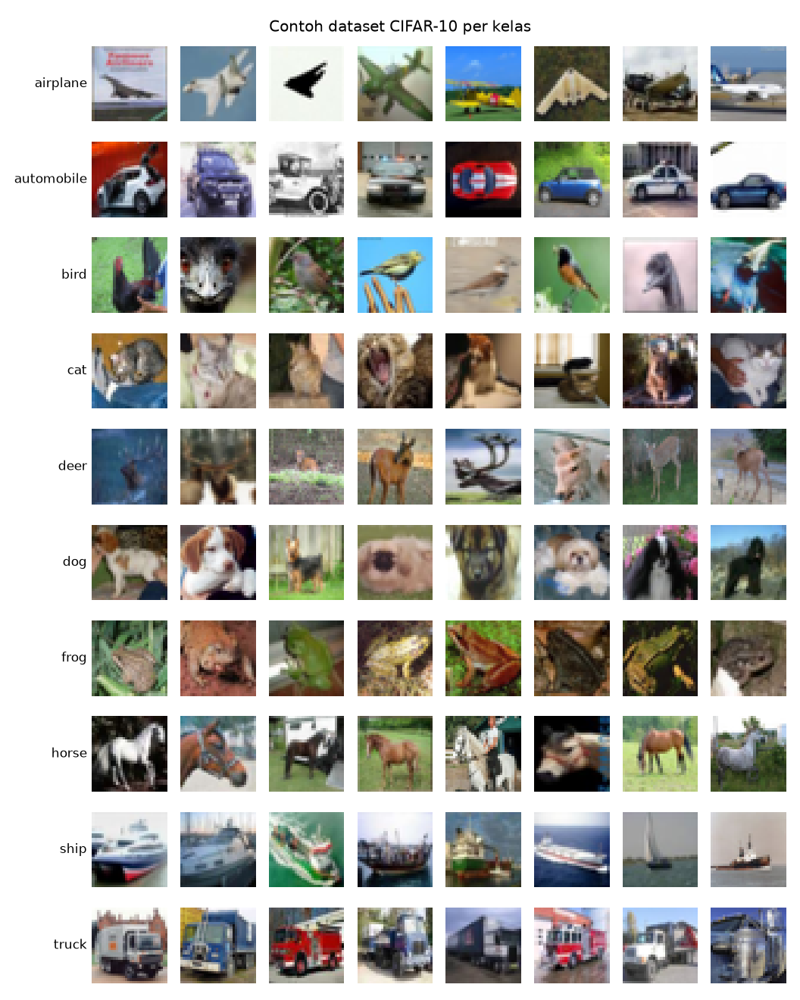
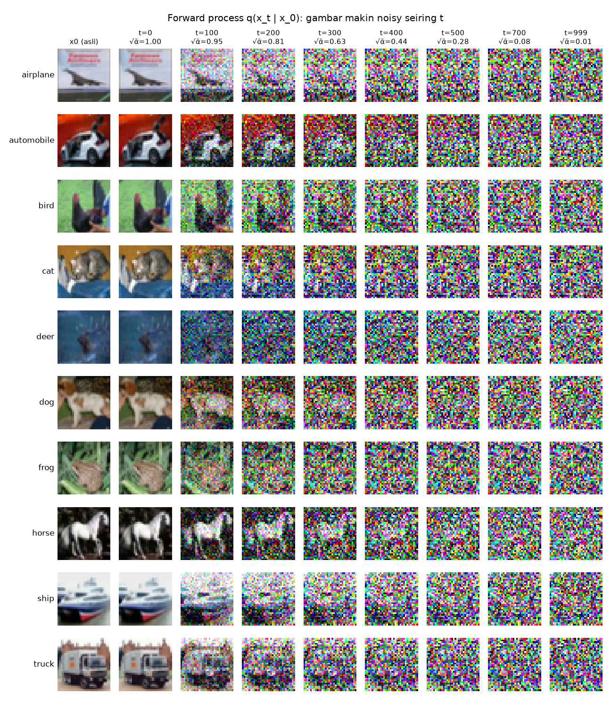
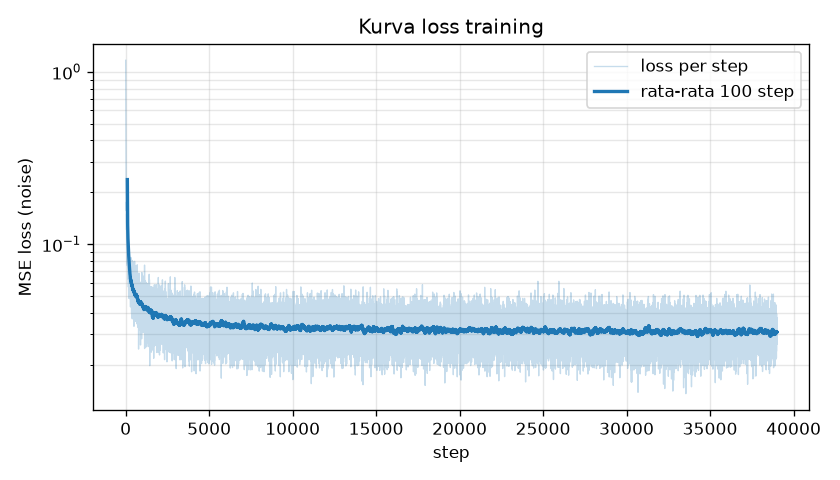
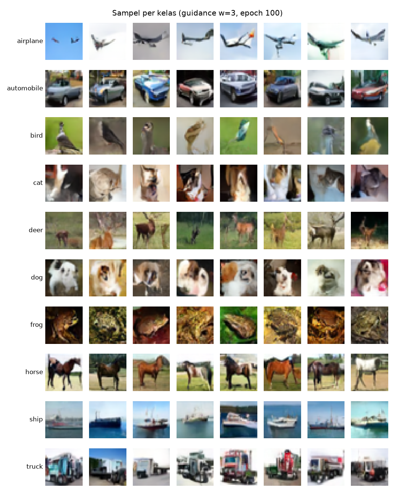
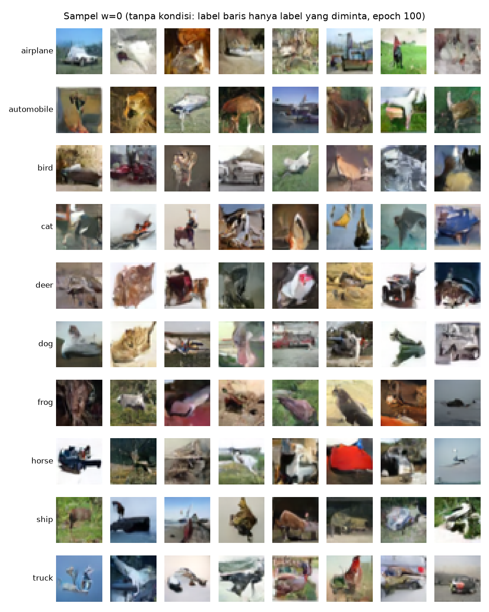
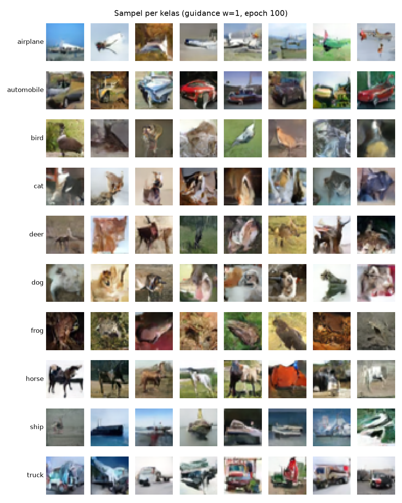
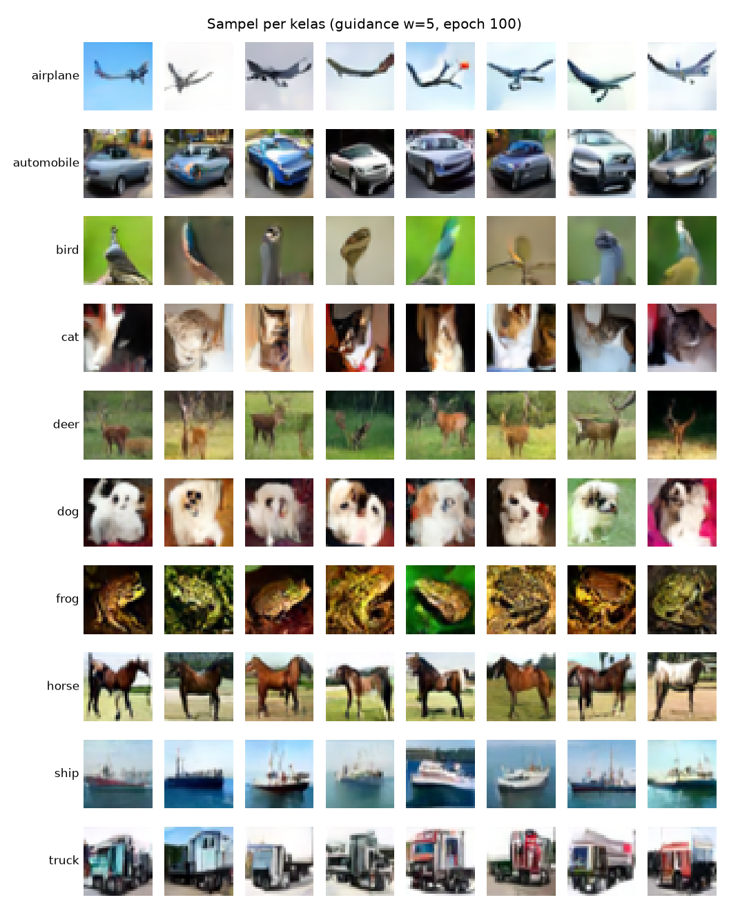
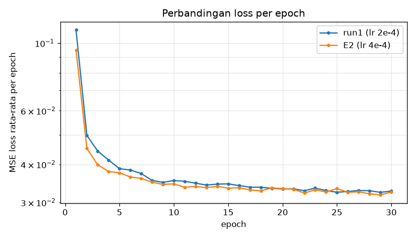
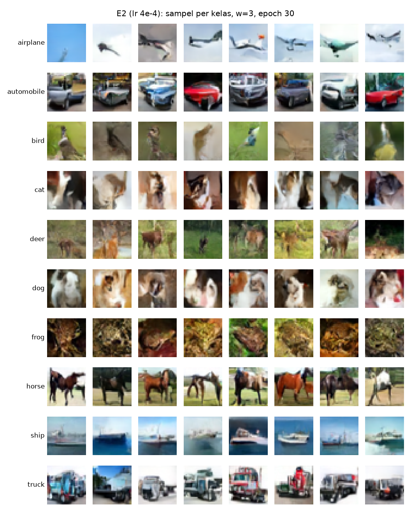

# Laporan Proyek 1 — Vibe Coding Generative AI from Scratch

**Class-conditional Mini DDPM pada CIFAR-10 (32×32)**

CAK4KBB3 Generative AI 2026-1 · Kelompok 14
- Satria Febry Andanu (103012300372), Ketua
- Gifan Apriadi (103012300385)

Repositori: https://github.com/ratrifa/mini-ddpm-cifar10
LLM: Claude Opus 5.5 (Claude Code)

> Status: **draf**. Bagian Hasil (4.1–4.3) sudah diisi dari run1, E1, dan E2; bagian bertanda _(isi)_ dilengkapi kelompok.

---

## 1. Pendahuluan

### 1.1 Latar belakang
_(isi: model generatif belajar distribusi data P(x), dan versi conditional belajar P(x | y). Hubungkan dengan materi GEN01.)_

### 1.2 Tujuan
- Membangun Denoising Diffusion Probabilistic Model (DDPM; Ho et al., 2020) skala kecil dari nol dengan PyTorch melalui kolaborasi dengan LLM (vibe coding), tanpa menyalin kode tutorial.
- Model dapat membuat gambar 32×32 untuk kelas CIFAR-10 yang dipilih (class-conditional).
- Mendokumentasikan seluruh interaksi dengan LLM: inisiasi → penanganan eror → optimasi.

### 1.3 Alasan memilih DDPM conditional pada CIFAR-10
_(isi: alasan kelompok. Catatan: Kelompok 4 sudah memakai Fashion-MNIST, sehingga kelompok ini memakai gambar berwarna.)_

### 1.4 Hubungan dengan materi kuliah
_(isi, opsional)_ Jembatan konsep: ELBO pada VAE (GEN06) → bound variasional DDPM; sampling dari prior N(0, I) seperti pada VAE; U-Net sebagai encoder–decoder CNN (02A) dengan residual block seperti ResNet (GEN02).

---

## 2. Dataset dan Data Pipeline

### 2.1 CIFAR-10
- 60.000 gambar RGB 32×32 dalam 10 kelas: airplane, automobile, bird, cat, deer, dog, frog, horse, ship, truck.
- 50.000 gambar train (dipakai untuk training) dan 10.000 gambar test (dipakai untuk visualisasi).
- Diunduh otomatis lewat `torchvision.datasets.CIFAR10`.

*Gambar 1. Delapan gambar test pertama dari tiap kelas.*

### 2.2 Preprocessing (`src/data.py`)
| Langkah | Detail | Alasan |
|---|---|---|
| `ToTensor()` | pixel [0, 255] → [0, 1], shape `(3, 32, 32)` | |
| `Normalize(0.5, 0.5)` | [0, 1] → [-1, 1] | Noise yang ditambahkan berdistribusi N(0, 1), sehingga data perlu berpusat di nol dengan skala sebanding |
| `RandomHorizontalFlip()` | p = 0.5, **hanya data train** | Versi cermin tetap realistis. Flip vertikal tidak dipakai karena model generatif akan ikut belajar menghasilkan gambar terbalik |
| `DataLoader` | batch 128; shuffle + `drop_last` untuk train | Ukuran batch tetap selama training |

Keluaran: gambar `(B, 3, 32, 32)` di [-1, 1] dan label `(B,)`. _(isi: tambahan penjelasan bila perlu)_

---

## 3. Arsitektur dan Metode

### 3.1 Forward process (`src/diffusion.py`)
- T = 1000 langkah dengan noise schedule linear β dari 1e-4 sampai 0.02.
- ᾱ_t = ∏(1 − β_s), sehingga x_t dapat dibuat langsung dari x_0 dalam satu langkah:

  x_t = √ᾱ_t · x_0 + √(1 − ᾱ_t) · ε,  ε ~ N(0, I)

- Implementasi: `Diffusion.q_sample(x0, t, noise)`. Indeks t berjalan dari 0 sampai T−1.

*Gambar 2. Forward process pada satu gambar per kelas dengan noise tetap. √ᾱ_t (sisa porsi sinyal asli) turun dari 1.00 ke 0.01. Objek masih jelas di t=100, samar di t=300, dan hilang di t ≥ 700.*

_(isi: interpretasi kelompok atas gambar ini)_

### 3.2 U-Net (`src/model.py`)
- Fungsi: memprediksi noise ε dari input (x_t, t, y).
- Encoder–decoder dengan skip connection. Tiga level resolusi 32 → 16 → 8 dengan channel 64 / 128 / 128, 2 ResBlock per level, dan 2 ResBlock di tengah.
- ResBlock: GroupNorm → SiLU → Conv, ditambah embedding, lalu dropout 0.1 dan koneksi residual.
- Timestep embedding: sinusoidal (seperti positional encoding Transformer) lalu MLP ke dimensi 256.
- Class embedding: `nn.Embedding(11, 256)`, berisi 10 kelas ditambah 1 token "tanpa kelas" untuk classifier-free guidance. Embedding waktu dan kelas dijumlahkan, lalu ditambahkan per channel di tiap ResBlock.
- Jumlah parameter: ±4,6 juta.

_(isi: diagram U-Net bila ada)_

### 3.3 Training (`src/train.py`, `notebooks/train.ipynb`)
| Komponen | Nilai |
|---|---|
| Loss | MSE antara noise asli ε dan prediksi model |
| Optimizer | Adam, lr 2e-4, gradient clipping 1.0 |
| Batch / epoch | 128 / 100 |
| Classifier-free guidance | label diganti token "tanpa kelas" dengan peluang 0,1 |
| EMA bobot | decay 0,999 (bobot EMA dipakai untuk sampling) |
| Checkpoint | `last.pt` di Google Drive, otomatis resume |
| Log | `loss_log.csv` (rata-rata per epoch), `loss_steps.csv` (per langkah) |
| Hardware | Google Colab, GPU T4; run1 100 epoch ± 3,1 jam (± 101–114 detik per epoch) |

### 3.4 Sampling / reverse process (`Diffusion.sample`, `src/sample.py`)
- Mulai dari noise murni x_T ~ N(0, I), lalu 1000 langkah dari t = T−1 ke 0.
- Tiap langkah: prediksi noise dengan dan tanpa kelas, digabung dengan classifier-free guidance ε = ε_uncond + w · (ε_cond − ε_uncond), default w = 3.0.
- x̂_0 ditebak dari x_t dan ε, di-clamp ke [-1, 1], lalu x_{t−1} diambil dari posterior q(x_{t−1} | x_t, x̂_0). Langkah terakhir tanpa noise.

---

## 4. Hasil

Tiga run dipakai di bagian ini. Rencana lengkapnya ada di [EXPERIMENTS.md](../EXPERIMENTS.md).

| ID | Perubahan dari baseline | Epoch | Loss epoch terakhir | Loss epoch 30 | Waktu |
|---|---|---|---|---|---|
| run1 | — (baseline: lr 2e-4, batch 128, T = 1000) | 100 | 0,0309 | 0,0327 | ± 3,1 jam training (Colab T4) |
| E1 | guidance scale w = 0 / 1 / 3 / 5 saat sampling (checkpoint run1) | 100 | — | — | 10 menit 10 detik untuk 4 skala × 80 gambar, di laptop (MPS M1 Pro) karena kuota GPU Colab habis |
| E2 | lr 4e-4 | 30 | 0,0325 | 0,0325 | ± 59 menit training (Colab T4) |

### 4.1 Kurva loss (run1)

*Gambar 3. Loss per langkah run1 (garis samar) dan rata-rata bergerak 100 langkah, sumbu y logaritmik. 39.000 langkah = 100 epoch × 390 langkah.*

- Loss per langkah turun dari 1,167 (langkah pertama) ke 0,029 (langkah terakhir). Rata-rata per epoch turun dari 0,1106 (epoch 1) ke 0,0309 (epoch 100); nilai terendah 0,0305 di epoch 79.
- Penurunan terbesar terjadi di ± 1.000 langkah pertama. Setelah itu kurva melandai di sekitar 0,03 dan hanya turun sedikit sampai akhir.
- Loss per langkah tetap berisik (± 0,02–0,06) sampai akhir karena timestep t dan noise diambil acak di tiap batch: memprediksi noise pada t kecil jauh lebih sulit daripada pada t besar. Karena itu tren dibaca dari garis rata-rata bergerak.
- Training sempat dijeda manual di tengah epoch 13 lalu dilanjutkan dari checkpoint epoch 12; kurva tidak menunjukkan lonjakan di titik itu.

### 4.2 Sampel per kelas dan guidance scale (E1)

Sampel dibuat dari bobot EMA run1 epoch 100, 8 gambar per kelas, dengan noise awal yang sama untuk semua skala (seed sama), sehingga perbedaan antar-grid hanya berasal dari guidance scale w.

*Gambar 4. Sampel run1 dengan w = 3 (nilai default). Tiap baris adalah kelas yang diminta.*

| w = 0 | w = 1 | w = 5 |
|---|---|---|
|  |  |  |

*Gambar 5. Sampel run1 dengan w = 0, 1, dan 5.*

- **w = 0** (tanpa kondisi): objek terbentuk, tetapi kelasnya acak dan tidak mengikuti label baris. Ini menunjukkan model juga belajar membuat gambar tanpa kelas (berkat label dropout 10%).
- **w = 1**: sebagian besar sesuai kelas, tetapi ada yang meleset (misalnya objek merah di baris kuda, kucing kabur).
- **w = 3**: semua baris jelas sesuai kelasnya. Pesawat di langit, kapal di air, katak, kuda, dan truk paling mudah dikenali; kucing dan anjing paling lemah bentuknya.
- **w = 5**: komposisi sama dengan w = 3 (seed sama), warna lebih jenuh dan kontras, tetapi variasi turun (anjing hampir semua berwajah putih).
- w = 3 dipertahankan sebagai default karena kelas sudah jelas tanpa kehilangan variasi seperti pada w = 5.

### 4.3 Learning rate 4e-4 (E2)

*Gambar 6. Loss rata-rata per epoch run1 (lr 2e-4) dan E2 (lr 4e-4), epoch 1–30.*

| Epoch | run1 (lr 2e-4) | E2 (lr 4e-4) |
|---|---|---|
| 1 | 0,1106 | 0,0951 |
| 5 | 0,0387 | 0,0375 |
| 10 | 0,0354 | 0,0345 |
| 15 | 0,0345 | 0,0334 |
| 20 | 0,0332 | 0,0333 |
| 30 | 0,0327 | 0,0325 |

- Dengan lr 4e-4, loss turun lebih cepat sampai ± epoch 15. Setelah itu kedua run menyatu di ± 0,033 dan pada epoch 30 selisihnya hanya 0,0002.
- Training dengan lr 4e-4 tetap stabil (tidak ada lonjakan loss), tetapi tidak memberi loss akhir yang lebih rendah dalam 30 epoch.

*Gambar 7. Sampel E2 (epoch 30, w = 3). Seed sama dengan Gambar 4, sehingga komposisinya mirip.*

> **Catatan: perbandingan visual E2 dan run1 tidak setara.** Gambar 7 berasal dari epoch 30, sedangkan Gambar 4 dari epoch 100. Checkpoint run1 pada epoch 30 tidak disimpan, jadi tidak ada sampel run1 pada jumlah epoch yang sama. Perbedaan kualitas antara kedua grid bisa berasal dari jumlah epoch, bukan dari learning rate. Perbandingan yang adil antara keduanya hanya kurva loss pada epoch 1–30 (Gambar 6).

### 4.4 Analisis
_(draf LLM, disetujui Gifan)_

1. **Kurva loss.** Hampir semua penurunan loss terjadi di awal training. Setelah sekitar epoch 20, loss cuma turun sedikit, dan nilai terendahnya di epoch 79. Artinya, dari sisi loss, 100 epoch sudah lebih dari cukup. Tapi loss yang mendatar tidak berarti gambarnya berhenti membaik. Loss DDPM adalah rata-rata kesalahan prediksi noise di semua t, jadi perbaikan detail gambar tidak selalu terlihat di angka loss. Kualitas sampel tetap harus dinilai dari gambarnya.
2. **Guidance scale.** Class conditioning terbukti bekerja: dengan w = 0 kelasnya acak, dan mulai w = 3 semua baris sesuai label. Ada trade-off antara kejelasan kelas dan variasi. w = 5 membuat warna berlebihan dan gambarnya makin seragam, jadi w = 3 dipilih sebagai titik tengah. Kucing dan anjing paling sulit, kemungkinan karena bentuknya mirip satu sama lain dan sangat bervariasi di resolusi 32×32.
3. **Learning rate.** lr 4e-4 mempercepat penurunan loss di awal, tapi keuntungannya hilang setelah sekitar epoch 15–20. Jadi menaikkan lr cuma berguna kalau waktu training sangat terbatas, dan tidak menghasilkan model yang lebih baik di akhir. lr 2e-4 tetap dipakai sebagai baseline.
4. **Keterbatasan.**
   - Evaluasinya hanya visual dan berdasarkan loss, tanpa metrik kuantitatif seperti FID.
   - Perbandingan visual E2 dan run1 tidak setara karena jumlah epoch-nya berbeda.
   - E3 (T = 500) tidak dijalankan. Kuota GPU Colab habis, dan di laptop 30 epoch butuh sekitar 2 jam 40 menit. Selain itu, dengan β yang sama, T = 500 masih menyisakan sekitar 8% sinyal di langkah terakhir, sehingga hasilnya sulit dibaca tanpa menyesuaikan `beta_end` (lihat [EXPERIMENTS.md](../EXPERIMENTS.md)).
   - Untuk ke depannya, cosine schedule, self-attention, atau model yang lebih besar bisa dicoba.

---

## 5. Pembagian Tugas
| Anggota | Peran | Modul / pekerjaan |
|---|---|---|
| Satria Febry Andanu (Ketua) | Prompt Engineer & LLM Navigator · Training Loop & Hyperparameter Tuning | `src/diffusion.py`, `src/model.py`, `src/train.py`, `src/sample.py`, `notebooks/train.ipynb`, tuning |
| Gifan Apriadi | Data Pipeline & Preprocessing · Lead Documentarian & Error Handler | `src/data.py`, `src/visualize.py`, `src/plot_loss.py`, kompilasi log, laporan, slide |

Alur kerja: tiap modul dikerjakan di branch sendiri (git worktree terpisah per anggota), dicek, lalu di-merge ke `main` dengan `--no-ff`. Rincian ada di [JOBDESK.md](../JOBDESK.md) dan [ROADMAP.md](../ROADMAP.md). _(isi: ringkasan jumlah commit per anggota)_

---

## 6. Log Interaksi LLM
| Sesi | Modul | Pelaksana | Log | Ekspor chat |
|---|---|---|---|---|
| 1 | Data pipeline + grid dataset | Gifan | [2026-11-07-data-pipeline.md](../logs/2026-11-07-data-pipeline.md) | _(isi)_ |
| 2 | Noise schedule + forward process | Satria | [2026-11-07-diffusion.md](../logs/2026-11-07-diffusion.md) | _(isi)_ |
| 3, 7 | Visualisasi forward process, kurva loss, grid sampel | Gifan | [2026-11-07-visualize.md](../logs/2026-11-07-visualize.md) | _(isi)_ |
| 4 | U-Net + embedding | Satria | [2026-11-07-model.md](../logs/2026-11-07-model.md) | _(isi)_ |
| 5 | Training loop + notebook | Satria | [2026-11-07-train.md](../logs/2026-11-07-train.md) | _(isi)_ |
| 6 | Sampling | Satria | [2026-11-07-sampling.md](../logs/2026-11-07-sampling.md) | _(isi)_ |
| 8 | Training penuh + tuning (run1, E1, E2) | Satria | [2026-11-08-tuning.md](../logs/2026-11-08-tuning.md) | _(isi)_ |

_(isi: ringkasan pola prompt, eror penting, dan pelajaran yang diambil)_

---

## 7. Kesimpulan
_(isi)_

## Referensi
1. J. Ho, A. Jain, P. Abbeel. *Denoising Diffusion Probabilistic Models*. NeurIPS 2020.
2. J. Ho, T. Salimans. *Classifier-Free Diffusion Guidance*. NeurIPS 2021 Workshop.
3. A. Krizhevsky. *Learning Multiple Layers of Features from Tiny Images* (CIFAR-10), 2009.
4. Materi kuliah CAK4KBB3: GEN01 Introduction, 02A Encoder-Decoder, GEN02 Review RNN/CNN, GEN06 VAE.
