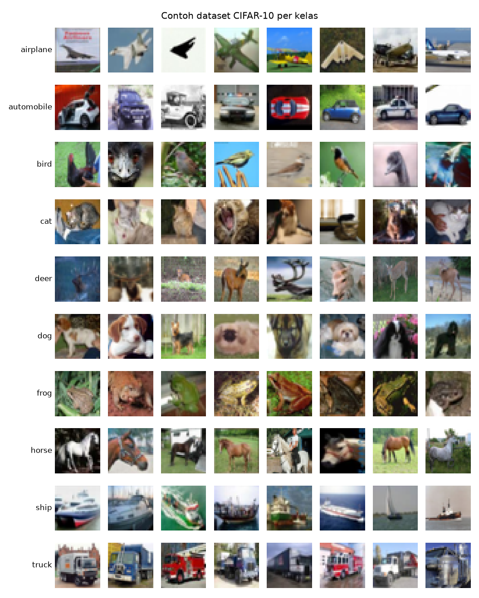

# LOG INTERAKSI LLM - KELOMPOK 14

- **Tanggal Sesi:** 07/11/2026
- **Pelaksana:** Gifan Apriadi (Data Pipeline & Preprocessing)
- **LLM:** Claude Opus 5.5 (Claude Code)
- **Target Modul:** Data pipeline CIFAR-10 (`src/data.py`) dan visualisasi contoh dataset (`src/visualize.py`)
- **Tautan Sesi Chat / Ekspor:** _(Sesi 1 berlangsung di sesi Claude Code awal sebelum sesi dipisah per anggota, yaitu sesi yang kemudian menjadi orchestrator; ekspor sesi orchestrator terlampir sebagai `export-orchestrator.pdf`)_
- **Commit terkait:** `ce99dc8`, `e45bbef` (merge `850a393`)

## KRONOLOGI PROMPT & RESPONS

### 1. TAHAP INISIASI (Meminta Kode Awal)

#### Prompt 1 — Loader dasar
- **Prompt Kelompok:** "buatin data.py buat load CIFAR-10 dengan normalisasi [-1, 1]"
- **Alasan Khusus:** Model difusi menambahkan noise Gaussian N(0, 1) ke gambar, sehingga gambar perlu berada di rentang yang berpusat di nol dengan skala yang sebanding dengan noise. Prompt sengaja dibuat singkat dan fokus pada satu kebutuhan dulu (load + normalisasi) sebelum menambah fitur lain.
- **Output Model:** Fungsi `get_dataloader(root, batch_size, train, num_workers)` dengan transform `ToTensor()` ([0, 255] → [0, 1]) lalu `Normalize((0.5,)*3, (0.5,)*3)` ([0, 1] → [-1, 1]); `shuffle` dan `drop_last` hanya untuk data train; konstanta `CLASSES` berisi 10 nama kelas; blok uji `python src/data.py`.
  ```python
  transforms.ToTensor(),                                   # [0, 255] -> [0, 1]
  transforms.Normalize((0.5, 0.5, 0.5), (0.5, 0.5, 0.5)),  # [0, 1] -> [-1, 1]
  ```
- **Hasil Uji:**
  ```
  jumlah data : 50000
  shape gambar: (64, 3, 32, 32)
  shape label : (64,)
  rentang     : [-1.000, 1.000]
  contoh label: ['bird', 'airplane', 'bird', 'cat', 'automobile']
  ```

#### Prompt 2 — Augmentasi
- **Catatan:** Sebelum prompt ini, kelompok meminta LLM memberi contoh prompt untuk langkah augmentasi dan visualisasi, lalu memakainya sebagai dasar.
- **Prompt Kelompok:** "Tambahin random horizontal flip di get_dataloader, tapi cuma buat data train. Data test jangan di-flip. Kasih juga alasan singkat kenapa flip horizontal cocok buat CIFAR-10, tapi flip vertikal nggak."
- **Alasan Khusus:** Menambah variasi data tanpa menambah jumlah gambar. Data test dibiarkan asli agar evaluasi dan visualisasi tidak terpengaruh augmentasi. Meminta alasan agar kelompok memahami dampak augmentasi pada model generatif, bukan hanya menerima kode.
- **Output Model:** `RandomHorizontalFlip()` (p = 0.5) ditambahkan di awal transform hanya bila `train=True`.
  ```python
  augment = [transforms.RandomHorizontalFlip()] if train else []  # p=0.5, hanya data train
  ```
  Penjelasan LLM: flip horizontal menghasilkan versi cermin yang tetap realistis (objek bisa menghadap kiri atau kanan), sedangkan flip vertikal menghasilkan gambar terbalik yang hampir tidak pernah ada di CIFAR-10. Pada model generatif, data terbalik akan ikut dipelajari sehingga model bisa menghasilkan gambar terbalik. Paper DDPM (Ho et al., 2020) juga hanya memakai horizontal flip untuk CIFAR-10.
- **Hasil Uji:** Urutan transform train `RandomHorizontalFlip → ToTensor → Normalize`, test `ToTensor → Normalize`. Gambar #0 diambil 20 kali: train menghasilkan 2 versi (asli + cermin), test selalu 1 versi. Rentang tetap [-1, 1].

#### Prompt 3 — Visualisasi grid
- **Prompt Kelompok:** "Bikin fungsi buat nampilin grid contoh dataset: 10 baris buat 10 kelas, tiap baris 8 gambar, nama kelas di kiri tiap baris. Gambar harus dibalikin dulu dari [-1, 1] ke [0, 1] sebelum ditampilin. Simpan hasilnya ke outputs/dataset_samples.png."
- **Alasan Khusus:** Memastikan secara visual bahwa label sesuai dengan gambar dan normalisasi tidak merusak warna. Fungsi pembalik normalisasi juga akan dipakai ulang untuk menampilkan hasil generate model.
- **Output Model:** File `src/visualize.py` berisi `to_display(x)` (`(x + 1) / 2`, clamp ke [0, 1], ubah `(3, H, W)` → `(H, W, 3)`) dan `show_dataset_grid(dataset, out_path, per_class=8)`. Grid memakai data test agar tidak tercampur gambar hasil flip.
- **Hasil:** `outputs/dataset_samples.png` (10 kelas × 8 gambar, warna normal, label sesuai).

  

### 2. TAHAP PENANGANAN EROR / DEBUGGING

Tidak ada eror saat kode dijalankan. Masalah yang ditemukan selama sesi:

#### Masalah 1 — Download dataset lambat
- **Gejala:** Uji pertama `python src/data.py` berjalan lebih dari 10 menit; kecepatan unduh dari server CIFAR-10 sekitar 150 KB/s (± 170 MB).
- **Analisis & Solusi Kelompok:** Bukan eror kode. Unduhan dibiarkan selesai; dataset tersimpan di `data/` sehingga hanya diunduh sekali di laptop. Folder `data/` diabaikan Git.

#### Masalah 2 — Gambar hasil tidak ikut ter-commit
- **Gejala:** `outputs/dataset_samples.png` tidak muncul di `git status`.
- **Penyebab:** `.gitignore` mengabaikan seluruh isi `outputs/` (`outputs/*`), padahal folder itu dimaksudkan untuk menyimpan gambar hasil laporan.
- **Prompt Perbaikan ke LLM:** "benerin gitignore terus commit atas nama gifan"
- **Analisis & Solusi Kelompok:** Menambahkan pengecualian `!outputs/*.png` sehingga file gambar ter-track, sementara file lain di `outputs/` tetap diabaikan. _(draf: tambahkan pelajaran yang diambil)_

## Ringkasan Sesi
| Kriteria (ROADMAP Sesi 1) | Status |
|---|---|
| Shape batch `(B, 3, 32, 32)`, label `(B,)` | ✅ |
| Rentang pixel [-1, 1] | ✅ |
| Grid contoh 10 kelas | ✅ |
