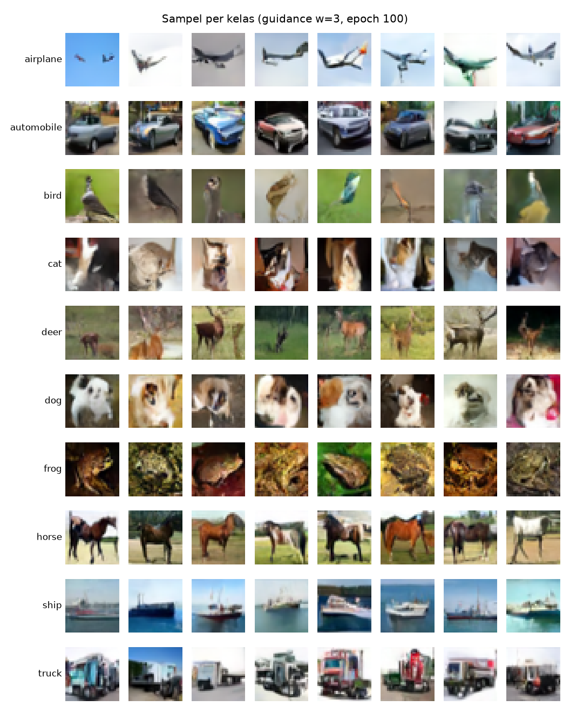

# LOG INTERAKSI LLM - KELOMPOK 14

- **Tanggal Sesi:** 07/11/2026
- **Pelaksana:** Satria Febry Andanu (Prompt Engineer & LLM Navigator · Training Loop & Hyperparameter Tuning)
- **LLM:** Claude Opus 5.5 (Claude Code)
- **Target Modul:** Sampling / reverse process (`Diffusion.sample` di `src/diffusion.py`, `src/sample.py`, cell sampling di `notebooks/train.ipynb`)
- **Tautan Sesi Chat / Ekspor:** _(terlampir pada berkas pengumpulan: `export-satria.txt`, ekspor `/export` sesi Claude Code Satria; tidak diunggah ke repo publik)_
- **Commit terkait:** `f68c2b2`, `0cd5c31` (merge `5d748a0`)
- **Status:** Kode selesai dan terverifikasi. Sampling dari checkpoint training penuh (run1, 100 epoch) sudah dijalankan di laptop (MPS) karena kuota GPU Colab habis. (Status di ROADMAP diperbarui oleh orchestrator.)

## KRONOLOGI PROMPT & RESPONS

### 1. TAHAP INISIASI (Meminta Kode Awal)

#### Prompt 1 — Permintaan kode
- **Prompt Kelompok:** "kerjain sesi 4-6"
- **Output Model:** LLM mengajukan pertanyaan desain sebelum menulis kode. Untuk Sesi 6 yang relevan adalah guidance scale.
- **Pilihan Kelompok:** **Guidance scale default 3.0** (opsi lain: 1.0 murni conditional, 5.0 kelas sangat tegas tapi rawan oversaturated).
- **Alasan Khusus:** _(dirumuskan bersama LLM, disetujui Satria)_ Nilai 3.0 membuat ciri kelas lebih jelas tanpa terlalu mengorbankan variasi. Pilihan ini terbukti di E1: guidance 3 menghasilkan semua kelas yang jelas, sedangkan guidance 5 membuat warna terlalu jenuh dan variasi turun.
- **Output Model:**
  - Di `src/diffusion.py` ditambahkan koefisien posterior q(x_{t−1} | x_t, x0) (Ho et al., 2020, persamaan 7) dan method `sample(model, labels, guidance_scale=3.0)`. Tiap langkah dari t = T−1 ke 0:
    ```python
    eps_cond, eps_uncond = model(torch.cat([x, x]), torch.cat([t, t]),
                                 torch.cat([labels, null])).chunk(2)
    eps = eps_uncond + guidance_scale * (eps_cond - eps_uncond)
    x0_pred = ((x - sqrt(1 - alpha_bar_t) * eps) / sqrt(alpha_bar_t)).clamp(-1, 1)
    mean = coef1 * x0_pred + coef2 * x
    x = mean + sqrt(posterior_variance_t) * z    # tanpa noise di langkah terakhir
    ```
    - Classifier-free guidance: prediksi noise dengan kelas dan tanpa kelas (token 10) dihitung dalam satu batch, lalu digabung.
    - Tebakan x0 dipotong ke [−1, 1] sebelum dipakai, sama seperti implementasi asli DDPM, agar sampel tidak keluar rentang gambar.
    - Hasil di rentang [−1, 1], sehingga bisa langsung ditampilkan dengan `to_display` milik `visualize.py` (Sesi 7).
  - `src/sample.py`: memuat checkpoint, membangun ulang U-Net dari `config` yang tersimpan, memakai bobot **EMA**, lalu menyimpan grid 10 baris (satu baris per kelas) × `--n-per-class` gambar.
  - Notebook: cell sampling ditambahkan di akhir `notebooks/train.ipynb`.
- **Hasil Uji 1 — kebenaran rumus (model "oracle"):** Model palsu yang selalu memprediksi noise sebenarnya untuk satu gambar target. Bila rumus reverse process benar, sampling harus menghasilkan gambar target itu persis.
  ```
  posterior_variance[0] = 0.0
  [cpu] shape (2, 3, 32, 32), maks |sampel - target| = 3.73e-09
  [mps] shape (2, 3, 32, 32), maks |sampel - target| = 3.73e-09
  ```
- **Hasil Uji 2 — `sample.py` dengan checkpoint uji coba Sesi 5** (baru 600 langkah training, laptop MPS, ± 2,5 menit):
  ```
  epoch checkpoint 4, guidance 3.0: (80, 3, 32, 32) rentang [-1.00, 1.00] -> .../smoke_samples.png
  ```
  Gambar masih berupa noise berwarna (wajar, model belum terlatih), tetapi tiap baris kelas sudah punya warna dominan berbeda, misalnya baris *ship* cenderung biru. Ini tanda awal bahwa class conditioning bekerja. Gambar ini tidak disimpan ke `outputs/` agar tidak tercampur dengan hasil akhir.

### 2. TAHAP PENANGANAN EROR / DEBUGGING

#### Masalah 1 — Cell sampling bergantung pada variabel cell lain
- **Gejala:** Draf pertama cell sampling memakai `CKPT = f"{RUN_DIR}/last.pt"`. Bila runtime Colab di-restart dan hanya cell sampling yang dijalankan, `RUN_DIR` belum terdefinisi (`NameError`).
- **Analisis & Solusi Kelompok:** Path checkpoint ditulis langsung di cell sampling (`/content/drive/MyDrive/mini-ddpm/run1/last.pt`) agar cell bisa dijalankan sendiri setelah setup.

#### Masalah 2 — Kuota GPU Colab habis setelah training penuh
- **Pesan dari Colab** (dialog saat menyambung ke runtime GPU, dilaporkan Satria ke sesi orchestrator):
```
Cannot connect to GPU backend
You cannot currently connect to a GPU due to usage limits in Colab.
To get more access to GPUs, consider purchasing Colab compute units with Pay As You Go.
```
  Dialog punya dua tombol, "Close" dan "Connect without GPU". Satria memilih "Close".
- **Konteks:** Muncul setelah training penuh run1 selesai (total durasi 100 epoch di `loss_log.csv` = 11.337 detik ≈ 3 jam 8 menit GPU, ditambah epoch 13 yang terpotong, uji coba, dan unduhan dataset sebelumnya). Akun Colab gratis punya batas pemakaian GPU yang tidak diumumkan pasti, sehingga cell sampling tidak bisa dijalankan di Colab.
- **Tindakan:** Satria mengunduh `last.pt` (± 74 MB), `loss_log.csv`, dan `loss_steps.csv` dari `MyDrive/mini-ddpm/run1` ke laptop (`checkpoints/run1/`). Sampling dijalankan di laptop dengan GPU Apple (MPS). Ini bisa dilakukan karena `sample.py` memilih device otomatis (CUDA → MPS → CPU) dan checkpoint menyimpan config model.
- **Analisis & Solusi Kelompok:** _(dirumuskan bersama LLM, disetujui Satria)_ Training penuh ± 3 jam ditambah uji coba menghabiskan kuota GPU Colab gratis. Karena checkpoint tersimpan di Drive dan menyimpan config model, sampling bisa dipindah ke laptop (MPS) tanpa mengubah kode. Hasilnya sama, hanya lebih lambat (± 2,5 menit per skala). Pelajarannya, kuota GPU adalah sumber daya terbatas yang perlu direncanakan: eksperimen yang hanya butuh sampling (E1) dijalankan di laptop, dan GPU disimpan untuk eksperimen yang butuh training (E2).

### 3. HASIL SAMPLING DARI CHECKPOINT TRAINING PENUH (run1)

- **Sumber:** sampling dijalankan oleh sesi orchestrator (sesi Claude Code lain yang mengoordinasikan Proyek 1) di laptop; hasilnya dicek ulang di sesi ini.
- **Checkpoint:** run1, epoch 100 (39.000 langkah), loss rata-rata epoch 100 = 0.0309. Training sempat dihentikan manual oleh Satria di tengah epoch 13 lalu dilanjutkan (resume) dari checkpoint epoch 12. `loss_log.csv` berisi epoch 1–100 masing-masing satu kali dan `loss_steps.csv` berisi 39.000 baris (100 × 390), jadi resume tidak menggandakan data.
- **Perintah** (laptop, MPS):
  ```
  python src/sample.py --ckpt checkpoints/run1/last.pt --out outputs/run1/samples.png --guidance-scales 0 1 3 5
  ```
  Total ± 10 menit 10 detik untuk 4 skala × 80 gambar. Semua skala menghasilkan `(80, 3, 32, 32)` dengan rentang [−1, 1]. Seed sama untuk tiap skala, jadi noise awal sama dan perbedaan murni dari guidance.
- **Hasil:** `outputs/run1/samples_g0.png`, `samples_g1.png`, `samples_g3.png`, `samples_g5.png` (+ `.pt`). Folder `outputs/run1/` diabaikan Git; versi berlabel untuk laporan dibuat Gifan dengan `visualize.show_sample_grid` dan tersimpan di repo sebagai `outputs/samples_g0_labeled.png`, `samples_g1_labeled.png`, `samples_g3_labeled.png`, `samples_g5_labeled.png`.

  
- **Pengamatan visual** (tiap baris = satu kelas: airplane, automobile, bird, cat, deer, dog, frog, horse, ship, truck):
  | Guidance | Pengamatan |
  |---|---|
  | 0 (tanpa kelas) | Objek sudah terbentuk (pesawat, mobil, hewan), tetapi kelas acak di tiap baris. Bagian unconditional model ikut terlatih. |
  | 1 | Sebagian besar baris sesuai kelas, masih ada yang meleset (misalnya objek merah mirip kendaraan di baris kuda, baris kucing kabur). |
  | 3 (default) | Semua baris jelas sesuai kelas. Kelas paling lemah: kucing dan anjing (wajah sering tidak utuh). |
  | 5 | Komposisi sama dengan skala 3, warna lebih jenuh/kontras, variasi berkurang (baris anjing hampir semuanya wajah putih). |
- **Kesimpulan sementara:** guidance 3 sebagai default sudah tepat untuk grid laporan; guidance 5 menukar variasi dengan konsistensi kelas. Perbandingan lengkap dicatat di `EXPERIMENTS.md` (E1).

## Ringkasan Sesi
| Kriteria (ROADMAP Sesi 6) | Status |
|---|---|
| Reverse process + classifier-free guidance | ✅ |
| Rumus terverifikasi (uji oracle, CPU dan MPS) | ✅ |
| Gambar hasil generate keluar (checkpoint uji coba, laptop) | ✅ |
| Gambar hasil generate dari checkpoint training penuh (run1, laptop MPS karena kuota GPU Colab habis) | ✅ |
