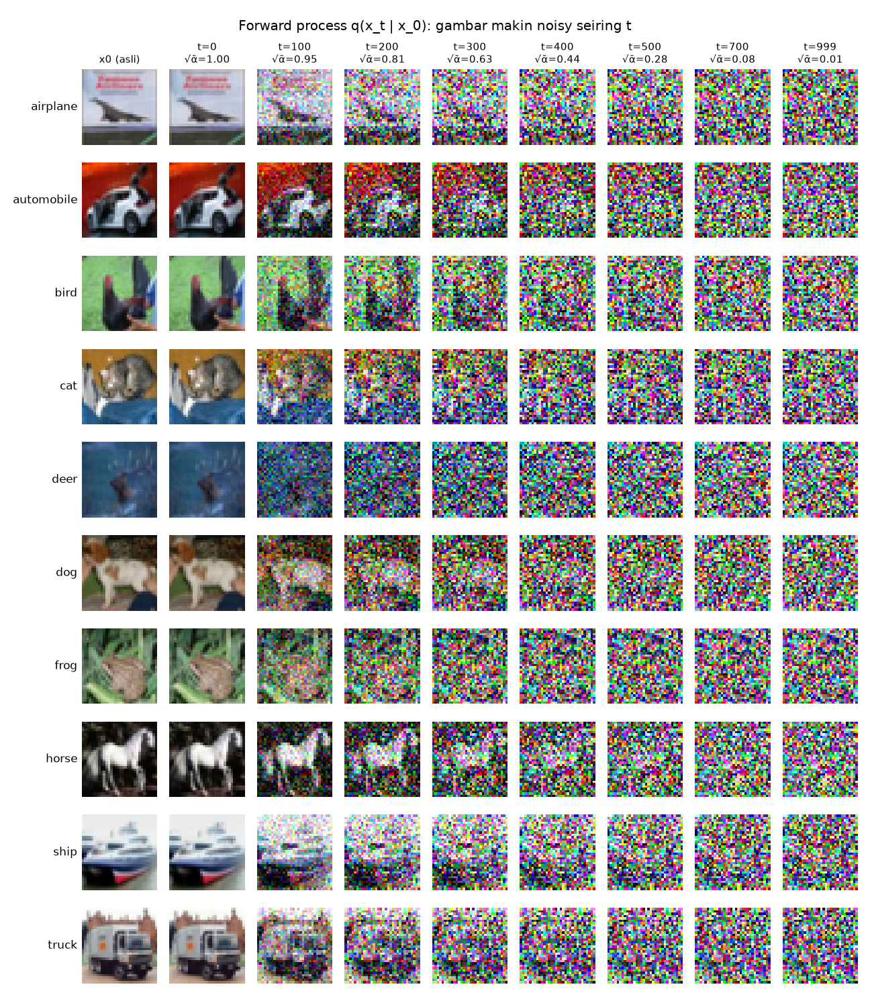
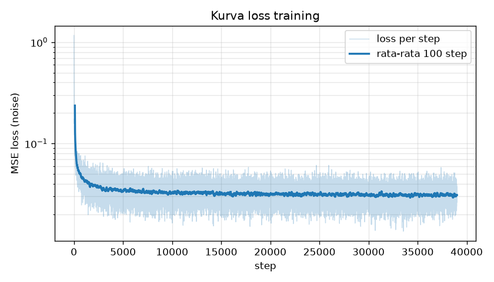
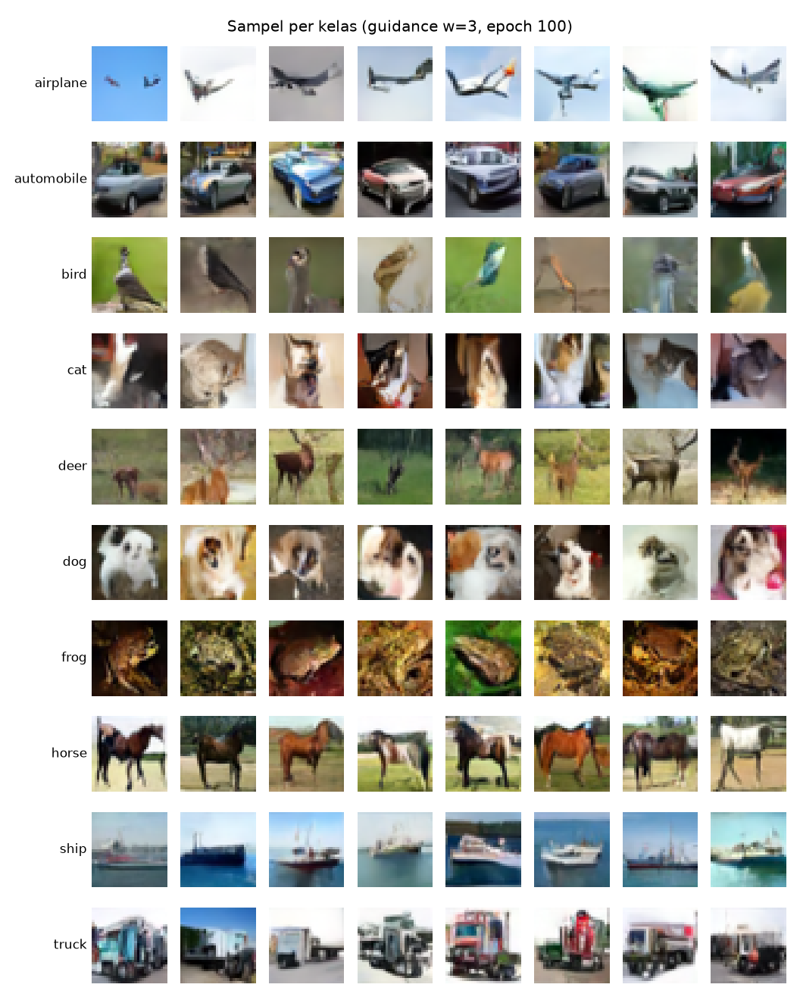

# LOG INTERAKSI LLM - KELOMPOK 14

- **Tanggal Sesi:** 07/11/2026
- **Pelaksana:** Gifan Apriadi (Data Pipeline & Preprocessing · Lead Documentarian)
- **LLM:** Claude Opus 5.5 (Claude Code), sesi terpisah dari sesi Satria (git worktree `project-1-gifan`)
- **Target Modul:** Visualisasi forward process (ROADMAP Sesi 3) dan kode kurva loss + grid sampel per kelas (ROADMAP Sesi 7, diuji dengan data palsu) di `src/visualize.py`; finalisasi log Sesi 1
- **Tautan Sesi Chat / Ekspor:** _(lampirkan file hasil `/export`)_
- **Commit terkait:** `b01329c`, `d40b39d`, `53ff8a2`, `a37ceaa`, `e198d8c`, `7a6d716`, `115d87b` (merge ke `main`: `3b98a16`, `8fa496b`, oleh sesi orchestrator)

## KRONOLOGI PROMPT & RESPONS

### 1. TAHAP INISIASI (Meminta Kode Awal)

#### Prompt 1 — Pembukaan sesi dan target Sesi 3 (dihentikan)
- **Prompt Kelompok:** "Gua Gifan. Baca dulu memory proyek ini, terutama session-handoff.md, midterm-group-context.md, sama no-pull-requests.md. Sesi Satria lagi jalan paralel di worktree project-1-satria, jadi jangan sentuh folder itu atau folder project-1. Bikin worktree baru buat gua di midterm-project/project-1-gifan dari main yang terbaru (git pull dulu). Semua commit di sesi ini atas nama gua. Kita ngerjain Sesi 3: visualisasi forward process pakai Diffusion.q_sample dari src/diffusion.py."
- **Alasan Khusus:** Sesi Satria sedang jalan paralel, jadi saya perlu worktree sendiri supaya tidak bentrok di Git. Commit atas nama saya supaya pembagian kerja terlihat di riwayat Git. `q_sample` disebut langsung supaya visualisasinya memakai rumus yang sama dengan training, bukan rumus yang ditulis ulang. _(draf LLM, disetujui Gifan)_
- **Output Model:** LLM membaca memory proyek, mengambil versi terbaru dari GitHub (`git fetch`; `main` lokal sudah sama dengan `origin/main` @ `30a1ad1`), lalu membuat worktree `project-1-gifan` di branch baru. Folder `project-1` dan `project-1-satria` tidak diubah. Sebelum kode ditulis, prompt ini dihentikan dan diganti Prompt 2.

#### Prompt 2 — Ganti target: log Sesi 1 + kurva loss + grid sampel
- **Prompt Kelompok:** "... Sesi 2 (diffusion.py) belum di-merge, jadi sekarang kita ngerjain yang nggak butuh file itu dulu: lengkapi log sesi 1 di logs/2026-11-07-data-pipeline.md, terus tulis fungsi kurva loss + grid sampel di src/visualize.py, dites pakai data palsu." _(bagian awal sama dengan Prompt 1)_
- **Alasan Khusus:** Saya kira `diffusion.py` belum di-merge, jadi saya kerjakan dulu bagian yang tidak bergantung pada file itu. Data palsu dipakai supaya fungsinya sudah teruji sebelum hasil training ada. _(draf LLM, disetujui Gifan)_
- **Output Model:**
  - Branch diganti nama menjadi `feat/visualize-results` agar sesuai isi pekerjaan.
  - `plot_loss_curve(losses, out_path, window=100)`: loss per step digambar samar, ditambah garis rata-rata bergerak 100 step, dengan sumbu y logaritmik. Alasan dari LLM: loss DDPM per step sangat berisik karena t dan noise diacak tiap batch, dan loss turun cepat di awal lalu melandai.
  - `show_sample_grid(samples, labels, out_path, title)`: satu baris per kelas dengan nama kelas di kiri. Kelas yang sampelnya lebih sedikit menyisakan sel kosong.
  - Bentuk input (loss per step berupa list, sampel `(N, 3, H, W)` di [-1, 1] beserta label) masih asumsi, karena `train.py` dan sampling (Sesi 5–6) belum ada.
- **Hasil Uji (data palsu, gambar tidak di-commit):**
  - Loss palsu: 5000 step, turun eksponensial dari ~1 ke ~0.03 dengan noise. Garis rata-rata terlihat jelas turun lalu datar. Kasus 50 step (lebih pendek dari window) hanya menampilkan garis mentah tanpa error.
  - Sampel palsu: 10 kelas × 8, sebagian nilai sengaja di luar [-1, 1] dan tetap tampil karena di-clamp oleh `to_display`. Kasus jumlah sampel per kelas tidak rata dan kasus 1 sampel juga berjalan.
- **Commit:** `b01329c`

#### Prompt 3 — Finalisasi log Sesi 1
- **Prompt Kelompok:** _(jawaban pilihan atas pertanyaan LLM)_ Alasan draf di log Sesi 1: "Draf udah sesuai"; file `/export`: "Belum ada".
- **Alasan Khusus:** Isi draf log Sesi 1 sudah sesuai dengan yang saya kerjakan. File `/export` memang belum saya buat. _(draf LLM, disetujui Gifan)_
- **Output Model:** Tanda "(draf, sesuaikan)" dihapus dari tiga bagian Alasan Khusus di `logs/2026-11-07-data-pipeline.md`. Tautan `/export` dan pelajaran Masalah 2 masih kosong.
- **Commit:** `d40b39d`

#### Prompt 4 — Lanjut Sesi 3
- **Prompt Kelompok:** _(Gifan menempelkan transkrip sesi koordinator tanpa kalimat tambahan. Transkrip itu menyebut Sesi 2 dan Sesi 4 sudah di-merge ke `main`, sehingga Sesi 3 bisa langsung dikerjakan.)_
- **Alasan Khusus:** Transkrip koordinator sudah memuat status terbaru (Sesi 2 dan 4 sudah di-merge), jadi cukup ditempel tanpa penjelasan ulang. _(draf LLM, disetujui Gifan)_
- **Output Model:** LLM melanjutkan target Sesi 3 dari Prompt 1:
  - `show_forward_process(images, diffusion, timesteps, out_path, row_labels)`: tiap baris satu gambar. Kolom pertama gambar asli x0, lalu x_t pada t = 0, 100, 200, 300, 400, 500, 700, 999, yang dibuat dengan `diffusion.q_sample`. Satu noise dipakai untuk semua kolom pada gambar yang sama, sehingga perbedaan antarkolom hanya berasal dari t. Judul kolom mencantumkan √ᾱ_t (sisa porsi sinyal asli).
  - Blok `python src/visualize.py [lokasi_data]` membuat grid untuk gambar test pertama dari tiap kelas dengan seed 0, sehingga hasilnya bisa diulang.
- **Hasil Uji:** `outputs/forward_process.png`. Objek masih jelas di t=100 (√ᾱ=0.95), samar di t=300 (0.63), dan hilang di t=700–999 (0.08 → 0.01). `dataset_samples.png` yang dibuat ulang identik dengan versi sebelumnya.

  
- **Commit:** `53ff8a2`

#### Prompt 5 — Pekerjaan selama training penuh berjalan
- **Prompt Kelompok:** _(ditempel; disusun bersama sesi koordinasi)_ "Selama training penuh jalan di Colab, kerjain ini berurutan. Tiap butir selesai, tes dulu, commit di branch sendiri atas nama gua, terus lanjut. Jangan sentuh train.py, data.py, diffusion.py, model.py. 1. Bikin cara buat baca loss_steps.csv terus gambar kurva loss pakai plot_loss_curve. Tes pakai file trial di <path loss_steps.csv>, dan jelasin ke gua kenapa pakai rata-rata bergerak dan sumbu log. 2. Bikin kerangka laporan akhir Proyek 1 sesuai panduan dosen: pendahuluan, dataset, arsitektur DDPM (forward process, U-Net, training, sampling), pembagian tugas, daftar log. Pakai gambar di outputs/, bagian hasil dikosongin dulu. 3. Dari kerangka itu, susun kerangka slide sekitar 10–12 slide, plus daftar pertanyaan yang kemungkinan ditanya dosen soal bagian gua (data pipeline dan visualisasi). 4. Terakhir, tunjukin satu per satu bagian "(isi sendiri)" di log sesi 3/7. Berhenti dan tanya gua di tiap bagian, gua jawab pakai kata-kata gua sendiri. Grid sampel berlabel nunggu format .pt dari sesi Satria. Kalau udah semua, kabarin orchestrator buat di-merge."
- **Alasan Khusus:** Training penuh makan waktu berjam-jam, jadi waktu tunggunya dipakai untuk pekerjaan yang tidak menyentuh kode training. Urutannya dibuat supaya tiap butir dites dan di-commit terpisah. _(draf LLM, disetujui Gifan)_
- **Output Model:**
  - Butir 1: `read_step_losses(csv_path)` di `visualize.py` membaca kolom `step,epoch,loss`. Bila satu step tercatat dua kali (Colab putus di antara penulisan CSV dan penyimpanan checkpoint), yang dipakai nilai terakhir. Skrip `src/plot_loss.py <loss_steps.csv> --out ... --window ...` memanggil `plot_loss_curve`. Commit `a37ceaa`.
  - Butir 2: `laporan/LAPORAN.md`, kerangka laporan berisi pendahuluan, dataset dan pipeline, arsitektur (forward process, U-Net, training, sampling), hasil (kosong), pembagian tugas, daftar log, dan referensi. Angka arsitektur diambil dari kode (±4,6 juta parameter dihitung langsung). Commit `e198d8c`.
  - Butir 3: `laporan/SLIDE.md`, kerangka 12 slide dan 20 pertanyaan latihan untuk bagian Gifan, tanpa jawaban. Commit `7a6d716`.
- **Hasil Uji butir 1:** Path file trial di prompt masih placeholder (`<path loss_steps.csv>`) dan file tidak ditemukan di laptop, sehingga uji memakai CSV sintetis berformat sama persis dengan keluaran `train.py` (400 langkah, 2 epoch × 200, ditambah epoch 2 tercatat ulang). Hasilnya 400 langkah terbaca, duplikat memakai nilai terakhir, dan gambar tersimpan. File trial asli tidak dipakai; pengujian dengan data asli dilakukan langsung pada run1 (Prompt 6).

### 2. TAHAP PENANGANAN EROR / DEBUGGING

Tidak ada eror saat kode dijalankan. Masalah yang ditemukan selama sesi:

#### Masalah 1 — Informasi status Sesi 2 tidak sesuai kondisi repo
- **Gejala:** Prompt 2 menyebut Sesi 2 belum di-merge, tetapi riwayat Git menunjukkan `diffusion.py` sudah masuk `main` di merge `ef50bb6`, dan Sesi 4 juga sudah masuk di `30a1ad1`.
- **Penyebab:** Dua sesi Claude berjalan paralel, sehingga informasi dari satu sesi bisa tertinggal dari kondisi repo yang sebenarnya.
- **Analisis & Solusi Kelompok:** LLM tetap mengerjakan permintaan Prompt 2 sambil memberi tahu kondisi sebenarnya, lalu Sesi 3 dikerjakan di sesi yang sama. Pelajaran: kalau dua sesi jalan paralel, status pekerjaan harus dicek langsung ke riwayat Git, bukan diambil dari ingatan atau sesi lain. _(draf LLM, disetujui Gifan)_

#### Masalah 2 — Dataset tidak ada di folder worktree
- **Gejala:** CIFAR-10 hanya tersimpan di `project-1/data/`. Folder `data/` diabaikan Git, sehingga worktree baru tidak memilikinya. Blok uji lama memakai `root="./data"` dengan `download=True`, yang akan mengunduh ulang ±170 MB (unduhan Sesi 1 butuh lebih dari 10 menit).
- **Analisis & Solusi Kelompok:** Blok `__main__` di `visualize.py` diberi argumen opsional lokasi data, lalu dijalankan dengan `python src/visualize.py ../project-1/data`. Tanpa argumen, perilakunya tetap seperti semula.

### 3. TAHAP OPTIMASI / HASIL AKHIR

#### Prompt 6 — Kurva loss dan grid sampel dari hasil training asli (run1)
- **Prompt Kelompok:** "Bikin kurva loss dari checkpoints/run1/loss_steps.csv dan grid sampel berlabel dari outputs/run1/samples_g*.pt, simpan di outputs/. Terus isi bagian "(isi sendiri)" di log visualize, lalu commit."
- **Alasan Khusus:** Keempat guidance scale dibuat grid-nya supaya pengaruh classifier-free guidance terlihat di laporan: w=0 tanpa kondisi, dan makin besar w, kelasnya makin jelas. _(draf LLM, disetujui Gifan)_
- **Commit:** `115d87b` (gambar); log ini menyusul.
- **Konteks:** Training run1 (100 epoch, 39.000 step, Colab T4) dan sampling 4 guidance scale (w = 0, 1, 3, 5; dijalankan di laptop karena kuota GPU Colab habis) dikerjakan di sesi Satria/orchestrator. File hasilnya ada di folder `project-1` dan tidak masuk Git.
- **Output Model:**
  - `python src/plot_loss.py <run1>/loss_steps.csv --out outputs/loss_curve.png`: 39.000 langkah terbaca, loss awal 1.1673, loss akhir 0.0293. Rata-rata per epoch (`loss_log.csv`) turun dari 0.1106 (epoch 1) ke 0.0309 (epoch 100).
  - `show_sample_grid` dipanggil untuk tiap `samples_g{0,1,3,5}.pt` (80 gambar, 8 per kelas, epoch 100) → `outputs/samples_g{0,1,3,5}_labeled.png`. Judul grid w=0 diberi keterangan bahwa sampel tidak terkondisi, jadi label baris hanya label yang diminta.
  - Tidak ada perubahan kode; fungsi dari Prompt 2 dan 5 langsung dipakai.
- **Hasil Uji:** Kurva rata-rata turun tajam di ±1.000 step pertama lalu melandai di ±0.03 sampai akhir; loss per step tetap berisik (±0.02–0.06). Pada grid w=3 tiap baris sesuai kelasnya (pesawat di langit, kapal di air, katak, kuda, truk terlihat jelas; kucing dan anjing paling kabur bentuknya).

  
  

### 4. ARAHAN / REVIEW DARI SESI ORCHESTRATOR
- Sesi orchestrator (sesi Claude yang ditunjuk user untuk koordinasi Proyek 1) meminta laporan status dan menetapkan aturan sementara: sesi anggota hanya commit di branch sendiri, sedangkan merge ke `main`, push, dan update ROADMAP dikerjakan orchestrator.
- Hasil review orchestrator: `show_forward_process`, `plot_loss_curve`, dan `show_sample_grid` dinyatakan benar dan lolos smoke test di `main`, tanpa permintaan perbaikan. Branch di-merge ke `main` (`3b98a16`), lalu ROADMAP diperbarui: Sesi 3 ✅, Sesi 7 🟨 (`5ab9f7f`).

## Ringkasan Sesi
| Kriteria (ROADMAP) | Status |
|---|---|
| Sesi 3: satu gambar ditampilkan makin noisy dari t=0 sampai T | ✅ |
| Sesi 7: kode kurva loss + grid sampel per kelas berjalan (data palsu) | ✅ |
| Sesi 7: grafik + grid dari hasil training asli siap untuk laporan | ✅ (run1, Prompt 6) |
| Log Sesi 1: alasan difinalkan | ✅ (tautan `/export` dan pelajaran Masalah 2 belum) |
